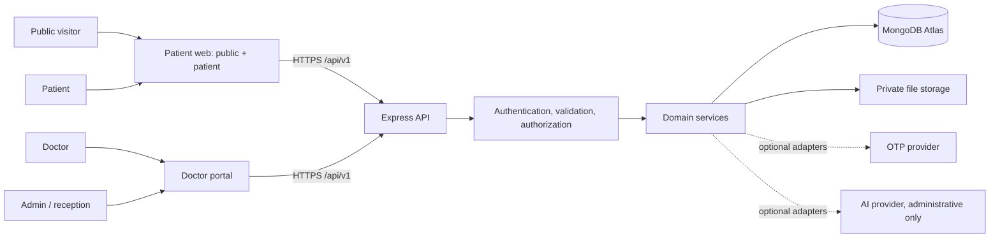

# Architecture

**Status:** Approved architecture; API bootstrap implemented  
**Date:** 12 November 2026

## Repository and runtime shape

Use a pnpm TypeScript monorepo with independently buildable/deployable frontends and a shared API:

```text
apps/
  patient-web/       Next.js public website + patient portal (/patient)
  doctor-portal/     Next.js doctor UI + admin UI (/admin)
  backend/           Node.js + Express REST API
packages/
  shared-types/      API contracts and shared domain types
  validators/        Shared Zod schemas
  utils/             Small framework-neutral utilities
  shared-ui/         Shared accessible UI primitives where deployment/build needs permit
database/
  models/            Mongoose models and indexes
  seed/              Synthetic development fixtures
docs/
```

The patient application owns the clinic's purchased domain. The doctor application can use its Vercel URL. Both call the same backend; the backend is not embedded separately in either frontend. Keep frontend packages independently deployable and do not require the doctor domain to be purchased. Use the proposed Next.js, React, TypeScript, Tailwind, shadcn/ui, Lucide, Express, MongoDB Atlas and Mongoose stack. Do not use PostgreSQL or Prisma.

## Logical architecture



## Backend boundaries

Organize API code by domain: auth/session, patients, doctors, specialities, schedules, appointments, consultations, prescriptions, medical records, notifications, audit, clinic settings and assistant. Route handlers authenticate, validate input, authorize the actor and resource, then invoke services. Services own business invariants and database transactions. Repositories/models isolate Mongoose. Provider adapters isolate OTP, AI, PDF/object storage and export details. Shared types/validators reduce contract drift but never replace server validation.

## Identity and authorization

Patient identity is mobile OTP. Doctors and administrators have distinct staff accounts and login paths; hash passwords with a maintained password-hashing algorithm. Use short-lived server-managed sessions with secure, HttpOnly, SameSite cookies and CSRF protection for cookie-authenticated state changes; session revocation and rate limits are required. Do not persist bearer tokens in browser local storage. Deployment must configure exact allowed origins for the two frontends, HTTPS, secure cookie behavior, and proxy settings. A production auth design review must confirm cross-origin cookie/domain behavior before deployment.

Enforce role-based permissions plus resource scoping (patient self, doctor assignment/clinic scope, admin operational scope) in backend services. Clinical note reads/writes have separate permissions from operational appointment data. Administrative overrides require explicit permission, reason where appropriate, and audit entry. Deny by default.

## Booking concurrency

Generate a slot from doctor availability, exceptions, duration, buffers and timezone rules. Treat displayed availability as advisory. Booking service rechecks eligibility and atomically claims a slot. Recommended design: canonical slot records with unique `(doctorId, startAt)` index and transactionally create appointment plus slot claim; alternatively enforce an equivalent unique active-booking key. Handle duplicate-key conflicts as “slot no longer available.” Ensure canceled appointments release/close claims correctly and rescheduling claims the replacement before releasing the old slot. Use MongoDB transactions on a supported Atlas replica-set deployment; retain unique-index protection as the final concurrency guard. Define idempotency for retryable booking requests.

## Data and files

MongoDB Atlas stores structured application records. ObjectIds for references; UTC instants for stored dates and clinic timezone for presentation and schedule interpretation. Private object storage holds PDFs/attachments; issue short-lived, authorized downloads or proxy through the API. Store metadata, ownership, classification and storage key in MongoDB, never public URLs. Backups, restoration tests, encryption and retention need environment-specific operational policy.

## Deployment topology

Development: local apps/API and synthetic data; mock OTP/AI. API bootstrap currently runs without MongoDB credentials, and reports not-ready until a URI is configured. Preview: independently deployed frontends and protected backend environment with synthetic data only. Production: patient app on clinic domain, doctor app on its Vercel URL initially, API on a separately selected commercial-capable host, Atlas production cluster, private file storage, secrets manager, monitoring and backups. Configure CORS, cookie/session settings and callback URLs per environment. Keep API portable to AWS or another provider. Vercel Hobby is for eligible prototypes, not commercial clinic production.

## Key decisions and rationale

- Two Next.js applications match the independent doctor deployment/domain decision, while sharing packages and one backend.
- Put admin under `/admin` in the doctor app per the final business decision, but treat its identity, permissions and navigation as distinct.
- Use a domain service boundary for shared online/staff booking behavior and concurrency safeguards.
- Keep documents out of MongoDB and use private object storage.
- Use OpenAPI-compatible REST contracts under `/api/v1`; the API document defines initial resources and endpoint map.
- Begin with mock OTP/AI and no payments; integrate providers only after clinic choices and security review.

## Repository inspection

At Phase 0 inspection, the workspace contained only `.vscode`; no application manifest, existing docs, package manager configuration, tests or source code were present. Environment supplied to this run is Windows PowerShell, workspace root `C:\Users\Lakshay Pal\Documents\Prisha's clinic`, client timezone `Asia/Calcutta` (clinic timezone remains explicitly `Asia/Kolkata`). This is a blank repository starting point; no existing implementation or deployment configuration was verified.

## Risks and mitigations

See [DEVELOPMENT_ROADMAP.md](DEVELOPMENT_ROADMAP.md) for the risk register. Highest risks are clinical-data exposure, booking races, OTP/session security, cross-origin authentication across domains, unspecified health-data/privacy obligations, and production hosting/backup/file-storage decisions.
