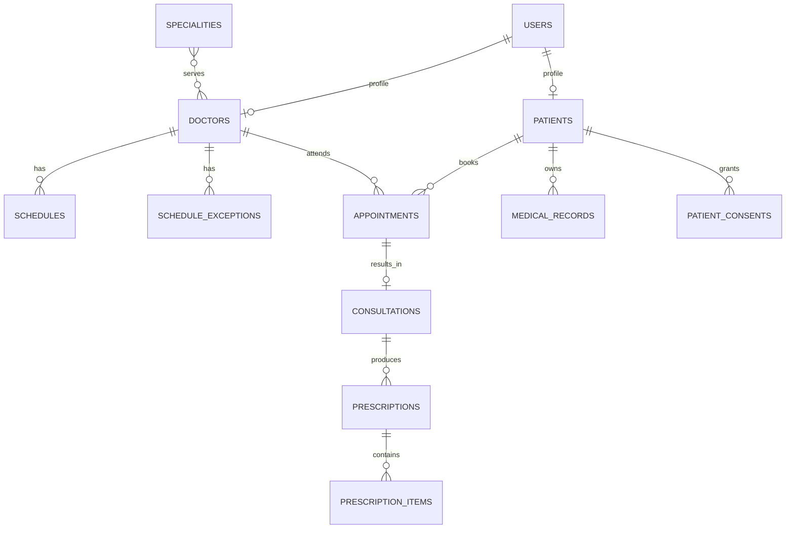

# Database Design

**Status:** Phase 0 proposal for approval  
**Database:** MongoDB Atlas with Mongoose  
**Date:** 12 November 2026

## Conventions

- Use MongoDB `ObjectId` primary keys and references. Store timestamps as UTC BSON dates; render and generate clinic schedules using `Asia/Kolkata`.
- Add `createdAt`, `updatedAt` where useful; include actor IDs and source on auditable workflows.
- Use enums and schema validation for state. Normalize high-risk/independently queried entities; avoid copying clinical text into operational documents.
- Minimize personal and clinical data. Never use real patient records in development. Soft deletion is not a substitute for an approved retention policy.

## Collections

| Collection | Main fields / references | Indexes and notes |
| --- | --- | --- |
| `users` | role, status, normalized mobile/email/login identifier, password hash for staff, session/security metadata | Unique partial indexes for normalized identifiers; never expose hashes |
| `patients` | `userId`, demographics and contact details, consent references/summary | Unique sparse `userId`; normalized mobile lookup; minimize demographics |
| `doctors` | `userId`, public profile content, speciality IDs, status, schedule configuration reference | Unique `userId`; `specialityIds` multikey |
| `specialities` | name, slug, public description, active flag | Unique slug |
| `schedules` | `doctorId`, effective date range, weekly availability rules, slot duration/buffers, timezone | `{doctorId, effectiveFrom, effectiveTo}`; validate overlapping rules in service |
| `scheduleExceptions` | `doctorId`, start/end, closed or override details, reason | `{doctorId, startAt, endAt}` |
| `appointments` | patient, doctor, speciality IDs; start/end UTC; source; status; booking actor; limited operational notes | `{doctorId, startAt}`, `{patientId, startAt desc}`, `{doctorId, status, startAt}`, `{status, startAt}`; unique active slot key strategy described below |
| `consultations` | appointment, patient, doctor IDs; clinical notes, diagnosis, status and timestamps | Unique `appointmentId` if one consultation per appointment; `{patientId, createdAt desc}`, `{doctorId, createdAt desc}`; strict clinical authorization |
| `prescriptions` | consultation, patient, doctor IDs; version, status, instructions, PDF metadata reference | `{patientId, createdAt desc}`, `{doctorId, createdAt desc}`, unique version per consultation |
| `prescriptionItems` | prescription ID; medicine, dose, frequency, duration, instructions, order | `{prescriptionId, order}`; alternatively embedded items if bounded and always read together |
| `medicalRecords` | patient ID, category, metadata, private storage key, uploader, access classification | `{patientId, createdAt desc}`, classification; file bytes remain in object storage |
| `notifications` | recipient, channel, template, status, payload minimization, sent time | `{recipientId, createdAt desc}`, `{status, nextAttemptAt}` |
| `otpRequests` | normalized mobile, purpose, hashed code/provider ref, expiry, attempts, consumed time | `{mobile, purpose, createdAt desc}`; TTL on `expiresAt` for cleanup; rate-limit across IP/mobile and avoid plaintext OTP |
| `auditLogs` | actor, action, resource type/id, timestamp, reason, request metadata, outcome | `{resourceType, resourceId, createdAt desc}`, `{actorId, createdAt desc}`; append-only application policy |
| `patientConsents` | patient ID, consent type/version, status, capture time, source, withdrawal time | `{patientId, consentType, createdAt desc}` |

The table describes logical fields, not final schemas. In particular, provider profile facts and privacy/retention requirements await clinic confirmation.

## Appointment double-booking invariant

MongoDB does not provide a general exclusion constraint for time ranges. Use discrete canonical slots for the clinic's supported appointment granularity. A `doctorSlots` collection (recommended addition to the requested list) can have `{doctorId, startAt, endAt, state, appointmentId}` with a unique compound `{doctorId: 1, startAt: 1}` index. Within a transaction, atomically claim the slot and create/update the appointment. Unique-index collision means another request won; return a conflict response. On cancellation, transition/release the claim according to policy in the same transaction. On rescheduling, claim the new slot and update appointment before freeing the prior slot. Use idempotency keys to safely retry requests.

If schedule granularity allows arbitrary start times, use a rigorously defined slot-key scheme or atomic reservation documents covering each occupied unit; checking for overlapping ranges in application code alone is unsafe under concurrency. Transactions require an Atlas topology supporting them. Unique indexes remain mandatory even when using transactions.

## Relationships

## Index and lifecycle guidance

Create indexes through versioned migrations/deployment scripts, not ad hoc startup assumptions. Verify uniqueness before adding unique indexes to existing data. TTL is suitable for expiring OTP records, not audit or clinical data. Define retention, correction, archival and legal hold policy with qualified clinic/privacy counsel before production. Audit records should not include full clinical content or OTP secrets. Back up Atlas and private files consistently; document restore procedures and test them.

## Privacy and access

Mongoose schemas are not authorization. Scope every query by actor and permitted patient/doctor relationship. Keep clinical fields out of general patient/admin list projections. Use explicit response DTOs, field allowlists, encryption in transit and managed encryption at rest. Log access to sensitive records and protect logs. Define who can correct a record and how corrections preserve history.
